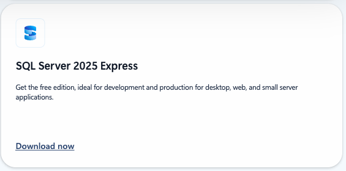
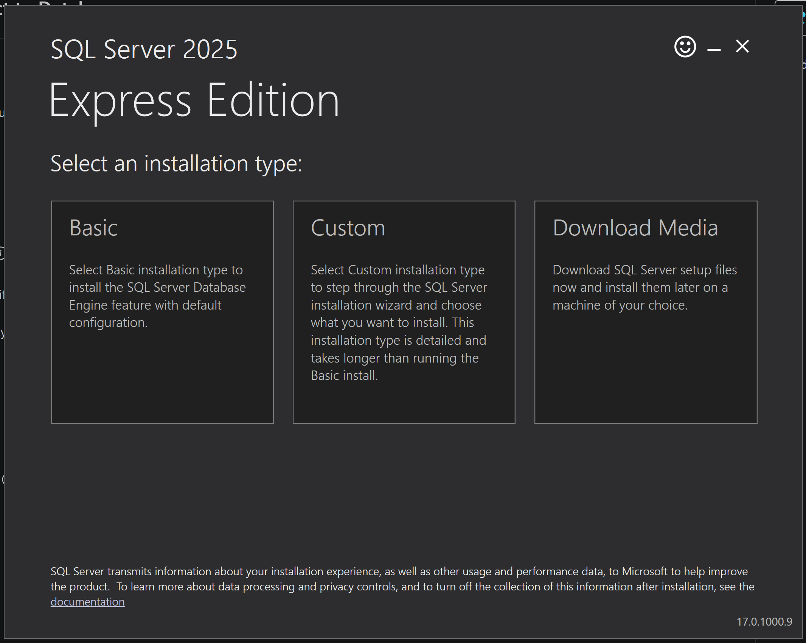
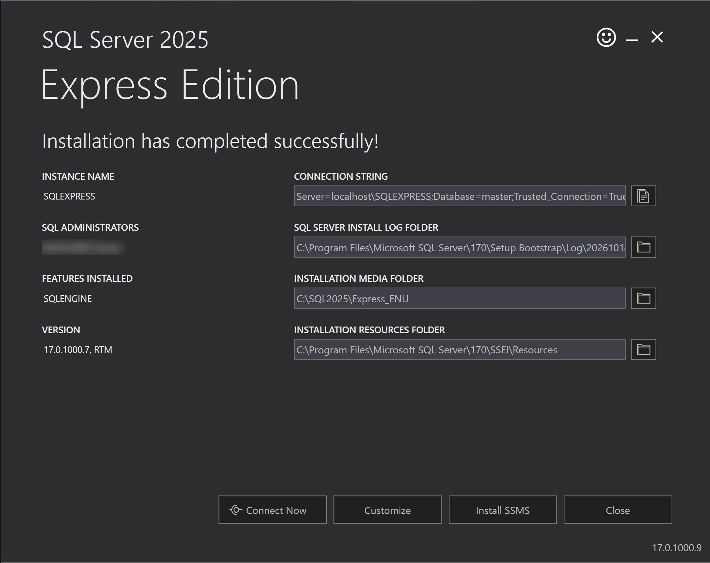
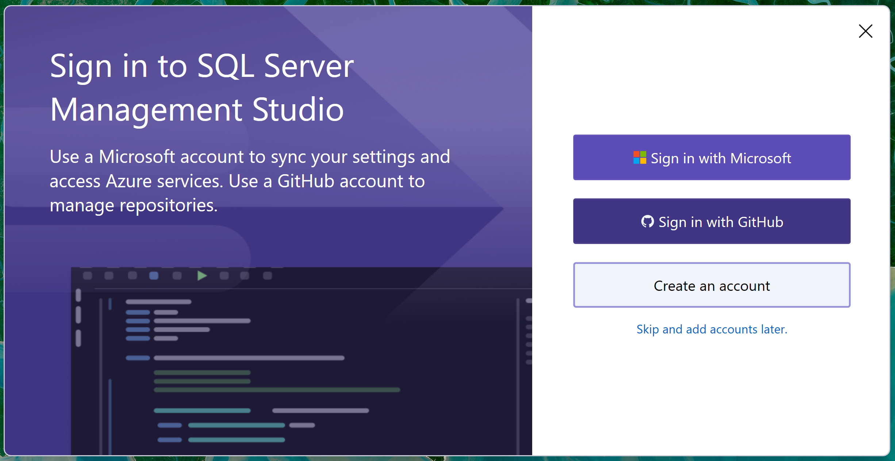
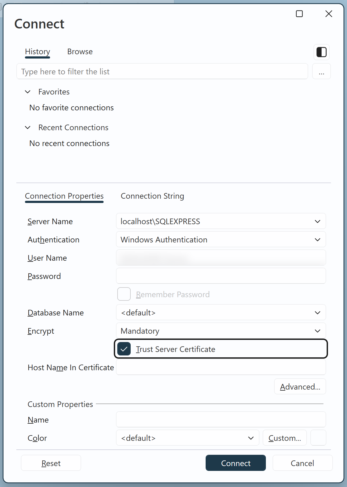
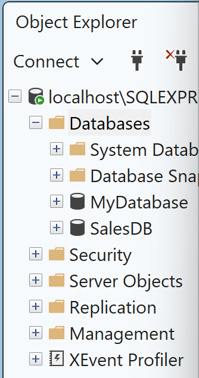
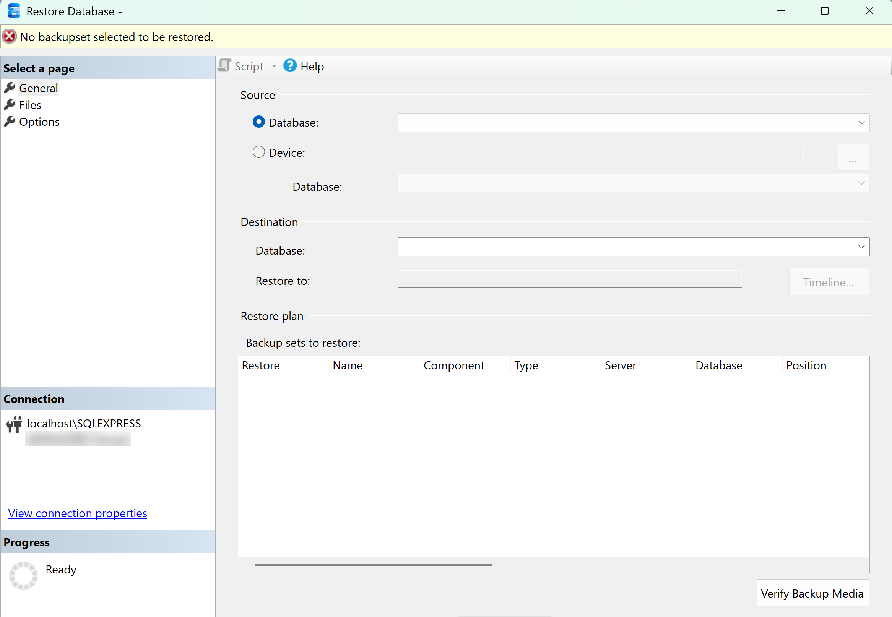
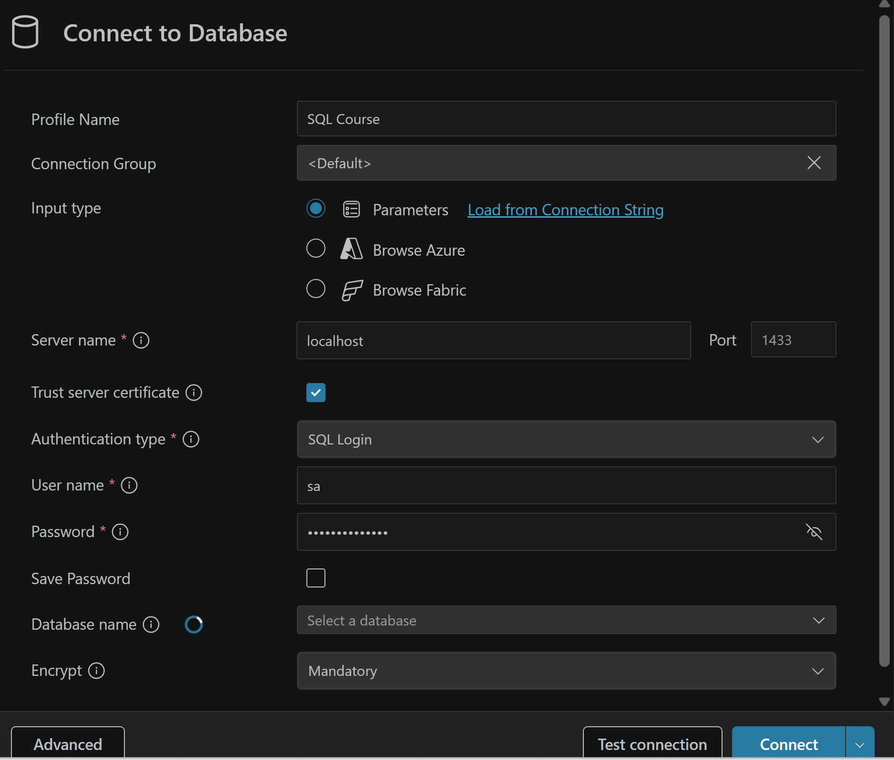

# Environment Setup

SQL Server, SSMS and the course databases, on Windows, Mac and Linux. The guide follows the Environment Setup lesson. It adds what the lesson could not show: the newer screens, the other ways to run SQL Server, and the fixes for the common errors.

## 1. Choose your setup

| Path | For | Same screens as the videos | Cost |
|---|---|---|---|
| **SQL Server Express + SSMS**, section 3 | Windows | yes | free |
| **Docker**, section 5 | Mac, Linux, Windows | the same SQL, in Visual Studio Code | free |
| **Parallels with Windows**, section 6 | Mac | yes, SSMS inside Windows | about 100 dollars a year, 14-day trial |

Read only your path. Windows: sections 3 and 4. Mac: section 5, or section 6 for Windows inside the Mac. Everyone: section 10 when something breaks.

My advice: on Windows, take the first path, it is the one in the videos. On a Mac, take Docker: free, light, and the SQL is the same. Take Parallels if you want SSMS exactly as in the videos and your Mac has 16 GB of memory.

## 2. What you get in the materials

Download the course materials once, from the lesson or from [GitHub](https://github.com/DataWithBaraa/sql-ultimate-course). You get this folder:

```
sql-ultimate-course/
├── datasets/
│   ├── sql-server/     init-sqlserver-mydatabase.sql, init-sqlserver-salesdb.sql,
│   │                   MyDatabase.bak, SalesDB.bak
│   ├── mysql/          the same two databases for MySQL
│   ├── postgres/       the same two databases for PostgreSQL
│   └── *.csv           the five SalesDB tables as CSV files
├── docker/             the one-click setup for Docker (section 5)
├── docs/               the slides of every chapter as PDF
└── scripts/            every query from the course, one file per chapter
```

The course uses two databases:

| Database | Used in |
|---|---|
| `MyDatabase` | SELECT, DDL, DML, Filtering Data, Joins, String Functions, Aggregate Functions |
| `SalesDB` | everything else, from Set Operators to AI and SQL |

Every script in `scripts/` starts with a `USE` line, so it tells you which database it needs.

## 3. Windows: install SQL Server and SSMS

The course runs on SQL Server Express, the free edition. The videos show SQL Server 2022. The download page now offers 2025, and it works the same.

1. Open the [SQL Server downloads page](https://www.microsoft.com/en-us/sql-server/sql-server-downloads), scroll to the **Express** card, and click **Download now**.
2. Run the downloaded file and choose **Basic**. Accept the licence and click **Install**.
3. The last screen shows your server name: `localhost\SQLEXPRESS`. Keep it, you need it in a minute. Your Windows account is now the administrator of this SQL Server.
4. Download [SQL Server Management Studio](https://aka.ms/ssms/22/release/vs_SSMS.exe) (SSMS) and install it with the default options. The installer may offer extra components. You need none of them.





### Connect for the first time

SSMS 21 and newer look different from the video.

1. At the first start, SSMS asks you to sign in. You do not need an account: click **Skip and add accounts later** under the buttons.
2. In the **Connect** window, type the server name `localhost\SQLEXPRESS`. If the field is empty, that is normal.
3. Authentication: **Windows Authentication**.
4. Tick **Trust Server Certificate**. Without it you get a certificate error.
5. Click **Connect**. Your server appears on the left, in the Object Explorer.




## 4. Create the databases

The lesson shows three ways. The first one is the easiest and works on every version.

### Way 1: run the scripts

1. In SSMS, click **File > Open > File** and open `datasets/sql-server/init-sqlserver-mydatabase.sql`.
2. Click **Execute**, or press F5. Refresh the Databases folder: `MyDatabase` is there.
3. Do the same with `init-sqlserver-salesdb.sql`. Before you run it, make sure the database dropdown in the toolbar says `master`.

Use only the scripts in `sql-server/`. The scripts in `mysql/` and `postgres/` are for other engines, and SSMS cannot run them.



### Way 2: restore the backups

1. Copy `MyDatabase.bak` and `SalesDB.bak` into the Backup folder of your SQL Server: `C:\Program Files\Microsoft SQL Server\MSSQL17.SQLEXPRESS\MSSQL\Backup` for SQL Server 2025, `MSSQL16` for 2022. SQL Server cannot read your Downloads folder, so this copy matters.
2. In the Object Explorer, right-click **Databases > Restore Database**.
3. Choose **Device**, click the three dots, click **Add**, pick the backup file, and click **OK** twice.



One rule to know: a backup restores on the same SQL Server version or a newer one, never on an older one. The course backups come from SQL Server 2022. On SQL Server 2019 or older, use way 1.

### Way 3: import the CSV files

Right-click a database, then **Tasks > Import Flat File**, and pick a CSV file. The lesson shows this as a demo. For the course, use way 1 or way 2. A CSV file cannot tell an empty text from NULL, and the NULL lessons need that difference.

## 5. Docker: Mac, Linux and Windows

SQL Server does not install on macOS, and SSMS is Windows only. With Docker, SQL Server runs in a small Linux container on any computer, and you write your queries in Visual Studio Code. The SQL is the same.

### Install, once

1. Install [Docker Desktop](https://www.docker.com/products/docker-desktop/). On a Mac, take the Apple chip version. Start it and leave it running.
2. On a Mac: Docker Desktop settings, **General**. Set the Virtual Machine Manager to **Apple Virtualization framework** and turn on **Use Rosetta for x86_64/amd64 emulation on Apple Silicon**. SQL Server ships for Intel chips only, and this setting lets your Mac run it.
3. Install [Visual Studio Code](https://code.visualstudio.com/download) and, inside it, the extension [SQL Server (mssql)](https://marketplace.visualstudio.com/items?itemName=ms-mssql.mssql) by Microsoft. It replaces Azure Data Studio, which Microsoft retired in February 2026.

### Start the course databases: one click

1. In the course materials, open the folder `docker` and double-click `start.command` on a Mac or `start.bat` on Windows. On Linux, run `docker compose up -d --build` in that folder.
2. Wait a minute. The first start downloads SQL Server and creates `MyDatabase` and `SalesDB` from the course scripts. From then on, a container called `sql-course` sits in Docker Desktop, and you start it from there.
3. In Visual Studio Code, open the SQL Server extension on the left and add a connection. Server name `localhost`, port `1433`, tick **Trust server certificate**, authentication **SQL Login**, user `sa`, password `SqlCourse!2026`.
4. Open a script from `scripts/`, run it against the connection, and you are in the course.



### The same by hand

If you prefer one command of your own, this starts an empty SQL Server 2022. Choose your own password: at least 8 characters with upper case, lower case, a number and a symbol.

```
docker run -e "ACCEPT_EULA=Y" -e "MSSQL_SA_PASSWORD=YourStrong!Passw0rd" \
  -p 1433:1433 --name sql --platform linux/amd64 \
  -d mcr.microsoft.com/mssql/server:2022-latest
```

Then connect as above and run `init-sqlserver-mydatabase.sql` and `init-sqlserver-salesdb.sql` from Visual Studio Code. Microsoft's own guide for this: [SQL Server in a Docker container](https://learn.microsoft.com/en-us/sql/linux/quickstart-install-connect-docker).

### The projects in Docker

The two projects load CSV files with `BULK INSERT`, and the scripts point to Windows paths. The one-click setup solves this. Unzip the three packages next to each other, like this. Then the project folders are visible inside the container under `/var/opt/mssql/sql/`, the same layout as `C:\sql\` in the videos.

```
sql-course/
├── sql-ultimate-course/
├── sql-data-warehouse-project/
└── sql-data-analytics-project/
```

In the project scripts, replace `C:\sql\` with `/var/opt/mssql/sql/` and the backslashes with slashes. `C:\sql\dwh_project\datasets\source_crm\cust_info.csv` becomes `/var/opt/mssql/sql/dwh_project/datasets/source_crm/cust_info.csv`. With the analytics project folder in place, the one-click setup creates the `DataWarehouseAnalytics` database for you too.

## 6. Windows inside your Mac: Parallels

This path gives you SSMS exactly as in the videos, because you run Windows on your Mac.

1. Install [Parallels Desktop](https://www.parallels.com/products/desktop/). It downloads and installs Windows 11 for you in a few clicks. It costs about 100 dollars a year, with a 14-day free trial, and Windows needs its own licence.
2. Give the virtual machine at least 6 GB of memory. A Mac with 16 GB is the comfortable minimum.
3. Inside Windows, follow section 3 like any Windows user.

SQL Server Express installs and runs on the ARM version of Windows 11, even though Microsoft does not list it as supported. Tested with SQL Server 2025 Express and SSMS 22 in Parallels on an Apple chip.

## 7. MySQL and PostgreSQL

The course is recorded on SQL Server, and that is the engine I recommend: every query in the videos runs as shown. If you still want MySQL or PostgreSQL, here is what to install, how to load the two databases, and the differences you will meet.

### Install and load

**MySQL**

1. Install [MySQL Community Server](https://dev.mysql.com/downloads/mysql/) and [MySQL Workbench](https://dev.mysql.com/downloads/workbench/). On Windows, the [MySQL Installer](https://dev.mysql.com/downloads/installer/) brings both.
2. In Workbench: **File > Open SQL Script**, open `datasets/mysql/init-mysql-mydatabase.sql`, and run it with the lightning icon.
3. The same with `init-mysql-salesdb.sql`.

**PostgreSQL**

1. Install [PostgreSQL](https://www.postgresql.org/download/) with the EDB installer, which brings pgAdmin. On a Mac, [Postgres.app](https://postgresapp.com/) is the lighter choice, with [pgAdmin](https://www.pgadmin.org/download/) or [DBeaver](https://dbeaver.io/download/) as the query tool.
2. Open `datasets/postgres/init-postgres-mydatabase.sql` in the query tool while connected to the `postgres` database, and run the lines up to `CREATE DATABASE`.
3. Connect to the new database and run the rest. The same with `init-postgres-salesdb.sql`.

Both engines keep the table names in lower case: `customers`, `orders`, `orders_archive` in MySQL, and `sales.customers` in PostgreSQL.

### What is different

Most of the course runs unchanged: SELECT, filtering, joins, set operators, CASE, aggregations, window functions, subqueries, CTEs, views. These are the parts that differ, and how to write them on the other engines.

| In the course (SQL Server) | MySQL | PostgreSQL |
|---|---|---|
| `SELECT TOP 3 * FROM t` | `SELECT * FROM t LIMIT 3` | `SELECT * FROM t LIMIT 3` |
| `GETDATE()` | `NOW()` | `NOW()` |
| `DATETRUNC(month, d)` | `DATE_FORMAT(d, '%Y-%m-01')` | `DATE_TRUNC('month', d)` |
| `DATENAME(month, d)` | `MONTHNAME(d)` | `TO_CHAR(d, 'Month')` |
| `DATEPART(year, d)`, `YEAR(d)` | `YEAR(d)` | `EXTRACT(YEAR FROM d)` |
| `EOMONTH(d)` | `LAST_DAY(d)` | `(DATE_TRUNC('month', d) + INTERVAL '1 month - 1 day')::date` |
| `DATEADD(day, 7, d)` | `DATE_ADD(d, INTERVAL 7 DAY)` | `d + INTERVAL '7 days'` |
| `DATEDIFF(day, a, b)` | `DATEDIFF(b, a)`, days only | `b - a` for dates |
| `FORMAT(d, 'yyyy-MM-dd')` | `DATE_FORMAT(d, '%Y-%m-%d')` | `TO_CHAR(d, 'YYYY-MM-DD')` |
| `CONVERT(DATE, x)` | `CAST(x AS DATE)` | `CAST(x AS DATE)` or `x::date` |
| `ISNULL(a, b)` | `IFNULL(a, b)` or `COALESCE(a, b)` | `COALESCE(a, b)` |
| `IIF(cond, a, b)` | `IF(cond, a, b)` | `CASE WHEN cond THEN a ELSE b END` |
| `LEN(s)` | `CHAR_LENGTH(s)` | `LENGTH(s)` |
| `CHARINDEX(x, s)` | `LOCATE(x, s)` | `POSITION(x IN s)` |
| `'a' + 'b'` for text | `CONCAT('a', 'b')` | `'a' \|\| 'b'` |
| `[Column Name]` | `` `Column Name` `` | `"Column Name"` |
| `Sales.Customers` | `customers`, MySQL has no schemas inside a database | `sales.customers` |
| `#temp` tables | `CREATE TEMPORARY TABLE` | `CREATE TEMP TABLE` |
| `SELECT ... INTO new_table` | `CREATE TABLE new_table AS SELECT ...` | `CREATE TABLE new_table AS SELECT ...` |
| `BULK INSERT` | `LOAD DATA INFILE` | `COPY ... FROM` |

The chapters on stored procedures, triggers, indexes, partitions, execution plans and performance tips are SQL Server chapters. The ideas carry over, the syntax does not. When a query from those chapters fails on another engine, that is the reason, not a mistake in your setup.

## 8. The project datasets

**Data Warehouse project**

1. The six CSV files sit in `datasets/source_crm` and `datasets/source_erp`.
2. The bronze loader reads them from `C:\sql\dwh_project\datasets\`, the folder used in the videos. Put the folder there, or change the six paths in `proc_load_bronze.sql`.
3. The folder must be readable by the SQL Server service. A folder directly on `C:\` works. Downloads often does not.

**Data Analytics project**

1. Restore `DataWarehouseAnalytics.bak` the same way as in section 4, or run `00_init_database.sql`, which loads the gold tables from `datasets/csv-files/`.
2. If you built the data warehouse project, you already have the gold layer.

## 9. AdventureWorks

The index chapter uses Microsoft's sample database `AdventureWorksDW2022`. It is not part of the course materials, so get it from Microsoft:

1. Open the [AdventureWorks sample databases](https://learn.microsoft.com/en-us/sql/samples/adventureworks-install-configure) page at Microsoft Learn.
2. Download `AdventureWorksDW2022.bak`, the data warehouse with `FactInternetSales`. `AdventureWorks2022.bak` is the other, operational database, and it does not have that table.
3. Restore it like the course backups, section 4, way 2.

The 2022 files need SQL Server 2022 or newer. On SQL Server 2019, take the 2019 files from the same page: the data is the same.

## 10. When something breaks

Find your message in the first column. The fix is in the last one.

**Install and connect**

| What you see | Why | What to do |
|---|---|---|
| SSMS asks you to sign in at the first start | optional account | Click **Skip and add accounts later** |
| The server name field is empty | normal | Type `localhost\SQLEXPRESS` |
| Error 26, "Error Locating Server/Instance Specified" | SQL Server is not running, or the name is wrong | Open **Services**, start "SQL Server (SQLEXPRESS)". If you installed the Developer edition, the name is `localhost` without the instance |
| "The certificate chain was issued by an authority that is not trusted" | SSMS encrypts the connection | Tick **Trust Server Certificate** |
| Installer: "Wait on the Database Engine recovery handle failed" | SQL Server could not start during setup | Uninstall SQL Server, restart Windows, install again. If it fails again, the real reason is in the ERRORLOG file under `C:\Program Files\Microsoft SQL Server\MSSQL17.SQLEXPRESS\MSSQL\Log` |
| SQL Server 2025 setup stops at the rules check | installer problem on some machines | Install SQL Server 2022 Express instead. The course runs on it |
| Your laptop does not let you install anything | no administrator rights | SQL Server needs them. Ask IT, or use a personal computer |

**Databases and files**

| What you see | Why | What to do |
|---|---|---|
| Msg 262, "CREATE DATABASE permission denied in database 'master'" | your Windows login is not an administrator of this SQL Server. Someone else installed it, often IT | Log in with the Windows account that installed SQL Server, or ask an administrator to add your login to the **sysadmin** role (Security > Logins > Properties > Server Roles) |
| Msg 911, "Database 'MyDatabase' does not exist", or many syntax errors with backticks | you ran the MySQL or PostgreSQL script in SSMS | Use the scripts in `datasets/sql-server/` |
| The restore window does not show the .bak file, or "Access is denied" | SQL Server cannot read Downloads | Copy the file into the Backup folder, section 4, way 2 |
| Msg 3169, the backup "is incompatible with this server" | your SQL Server is older than 2022 | Run the scripts, way 1, or install SQL Server 2022 or 2025 Express |
| "'DATETRUNC' is not a recognized built-in function name" | SQL Server older than 2022 | Install SQL Server 2022 or newer. The course uses functions from 2022 |
| Msg 4860, "Cannot bulk load. The file does not exist or you don't have file access rights" | the path in the script is not your folder, or SQL Server cannot read it | Put the datasets folder on `C:\` and fix the path in the script |
| A .sql file opens in Notepad, or the .bak shows as text in the browser | the file is not linked to SSMS | Open SSMS first, then **File > Open > File**. For downloads, right-click the link and choose **Save link as** |

**Docker**

| What you see | Why | What to do |
|---|---|---|
| "Cannot connect to the Docker daemon" | Docker Desktop is not running | Start Docker Desktop, wait for the whale icon, try again |
| "no matching manifest for linux/arm64" | the Intel image needs emulation | Add `--platform linux/amd64` to the command and turn on Rosetta in Docker Desktop |
| "port is already allocated" | another SQL Server listens on 1433 | Stop it, or change the first `1433` in `docker-compose.yml` to `1434` and connect to port `1434` |
| The container stops right after the start | the password breaks the rules | At least 8 characters with upper case, lower case, a number and a symbol |

If you are still stuck, write in the Q&A with the exact error message and a screenshot of the window. Then I can see what happened.
